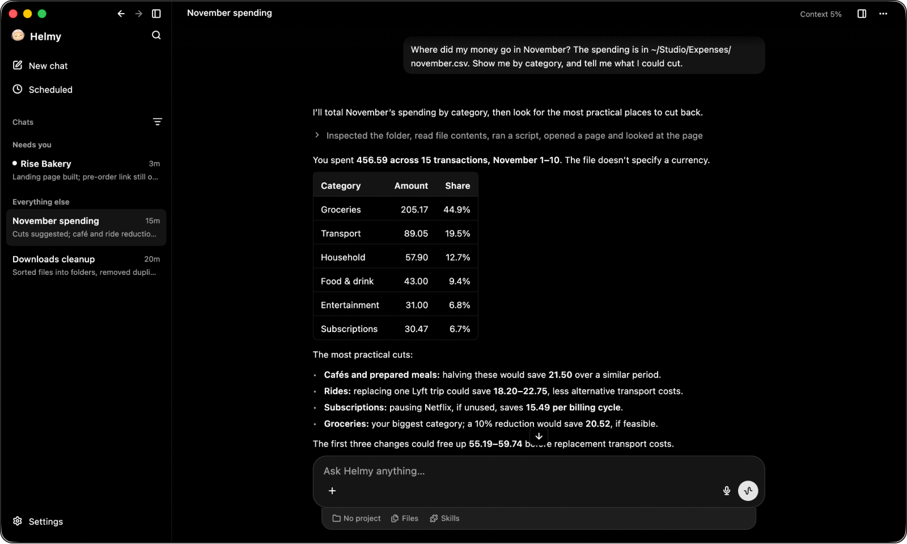

<p align="center">
  
</p>

<h2 align="center">Dream it. Do it.</h2>

<p align="center">
  Tell Helmy what you want done, and it does the work in your folders and accounts.
</p>

<p align="center">
  <a href="https://github.com/mittolabs/helmy/actions/workflows/app.yml"></a>
  <a href="https://github.com/mittolabs/helmy/releases/latest"></a>
  
  <a href="LICENSE"></a>
</p>

<p align="center">
  <a href="https://github.com/mittolabs/helmy/releases/latest"></a>
</p>

## Get started

Download Helmy for your system from the [latest release](https://github.com/mittolabs/helmy/releases/latest).

The macOS build is not signed yet, so macOS stops it the first time. Open it once, then go to
**System Settings › Privacy & Security** and choose **Open Anyway**.

On first run Helmy sets up a free connection that needs no account. If you already pay for
Claude Code or Codex, switch it on during setup or later in Settings, and Helmy uses it too.

## Build from source

Needs [fvm](https://fvm.app) and Xcode.

```sh
make setup   # once: the commit hook and dependencies
make run     # build the macOS app and open it
make test    # unit tests
```

How the repository is laid out, and the rule everything in it follows, is in
[CLAUDE.md](CLAUDE.md).

## License

BSD 3-Clause. See [LICENSE](LICENSE).
